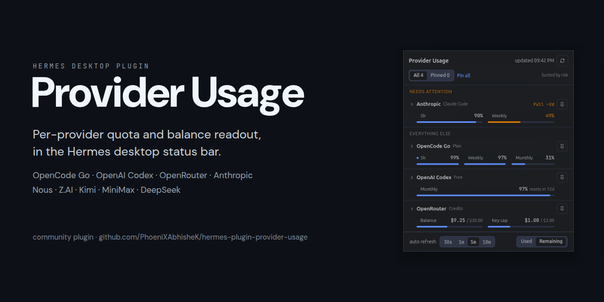
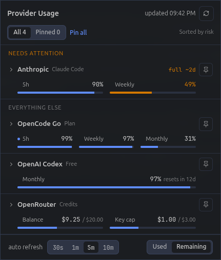
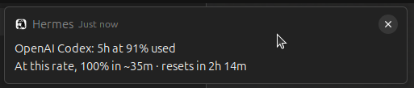

# Provider Usage



Per-provider quota and balance readout in the Hermes desktop status bar:
**OpenCode Go**, **OpenAI Codex**, **OpenRouter**, plus **Anthropic**,
**GitHub Copilot**, **Nous**, **Z.AI**, **Kimi**, **MiniMax**, and
**DeepSeek** when configured.

Providers appear only when their credentials are usable; unconfigured
providers are omitted from the panel entirely.

## Screenshots






## What it shows

- **Status bar**: the providers you pick with the eye toggles, e.g.
  `opencode 6% · codex 2% · openrouter $0.32` (5h windows for quota providers,
  key-cap figure for OpenRouter; flips with Used/Remaining). Until a toggle
  is touched, only the first provider shows.
- **Popover**: dense rows with every window, reset times, balance and key-cap
  amounts, and a manual refresh button.
- **Near-limit tint**: any window or the OpenRouter key cap at 80%+ used
  renders amber in the bar and in the popover.
- **Native alerts**: one desktop notification per threshold crossing, deduped
  per window cycle (keyed by the reset time) and once a day for the key cap.
- **Burn-rate projections**: `~2d` appears next to a window when it would hit
  100% before its own reset at the currently observed rate; caps show the
  projected exhaustion when inside 14 days.
- **Rate limits**: a provider that answers `429` with `retry-after` is not
  called again until that time; the popover keeps the last reading and adds
  `last reading · retry after HH:MM` instead of hiding the provider. Holds
  are in memory, so a backend restart queries once more.
- **Footer controls**: auto refresh picker (30s / 1m / 5m / 10m) and a
  Used/Remaining toggle. Both persist across app restarts.
- **Provider toggles**: an eye button on each provider header shows or hides
  that provider in the status bar. Persists across app restarts.

## Providers and what it reads

| Provider | Credential (read-only) | Endpoint |
|---|---|---|
| OpenCode Go | `OPENCODE_GO_API_KEY` via the Hermes secret scope, else the `opencode-go` entry of `~/.local/share/opencode/auth.json` (never the Zen key; without a Go plan the card stays hidden) | `https://opencode.ai/zen/go/v1/usage` |
| OpenAI Codex | Hermes' Codex sign-in (account-usage helper), else the OAuth access token in `~/.codex/auth.json`; the `OPENAI_API_KEY` entry in that file is never used. A reading more than ten minutes old is refreshed with that token, at most once per five minutes | `https://chatgpt.com/backend-api/wham/usage` |
| OpenRouter | `OPENROUTER_API_KEY` via the Hermes secret scope; a balance read needs a management key, so a normal key shows the key cap only | `https://openrouter.ai/api/v1/key`, `https://openrouter.ai/api/v1/credits` |
| Anthropic | Hermes' Claude Code sign-in (account-usage helper), else the Claude Code OAuth token in `~/.claude/.credentials.json`; a refused helper read keeps the last reading for up to six hours, marked stale, and once that reading is more than ten minutes old the direct token is tried at most once per five minutes | `https://api.anthropic.com/api/oauth/usage` |
| GitHub Copilot | Hermes' Copilot token resolver | `https://api.github.com/copilot_internal/user` |
| Nous | Hermes' Nous Portal sign-in | `https://portal.nousresearch.com/api/oauth/account` (subscription windows, else the credit balance as money rows) |
| Z.AI / GLM | `ZAI_API_KEY` or `GLM_API_KEY` | `https://api.z.ai/api/monitor/usage/quota/limit` |
| Kimi | `KIMI_API_KEY` or `MOONSHOT_API_KEY` | `https://api.kimi.com/coding/v1/usages` (falls back to the Moonshot balance at `https://api.moonshot.ai/v1/users/me/balance`, then `https://api.moonshot.cn/v1/users/me/balance`) |
| MiniMax | `MINIMAX_CN_API_KEY` (mainland) or `MINIMAX_API_KEY` (global); the CN key is tried first and both are probed when both are set, since M Plan subscription keys are region-bound | `https://api.minimaxi.com/v1/token_plan/remains` then `https://www.minimax.cn/v1/token_plan/remains` for mainland, `https://api.minimax.io/v1/token_plan/remains` then `https://www.minimax.io/v1/token_plan/remains` for global |
| DeepSeek | `DEEPSEEK_API_KEY` | `https://api.deepseek.com/user/balance` |

OpenCode Zen (the metered API) is not tracked yet; this card covers the Go subscription.

## Privacy

- **Read-only credentials.** The plugin writes nothing back to any credential
  file and never mints or refreshes a token itself. No browser cookies, no
  credential CLIs. Providers marked as resolved by Hermes use the app's own
  account-usage helpers (the same code path as Hermes' `/usage` surfaces,
  including Hermes' normal credential upkeep).
- **No subprocesses.** Every provider call is an in-process `httpx` request;
  nothing is shelled out, and no helper process ever sees a credential.
- **Sanitized error text.** A provider failure shown in the panel is short and
  single line. The only provider text used is a Z.AI `msg` or a MiniMax
  `status_msg`; it is capped at 120 characters, and the request's credential and
  any token-shaped string are redacted. Every other failure shows a shape such
  as `timeout` or `HTTP 500`; the raw detail goes to the backend log with the
  credential redacted.
- **Client identity disclosure.** The GitHub Copilot check queries GitHub's
  internal Copilot usage endpoint presenting the VS Code / Copilot client
  identity (`Editor-Version`, `User-Agent`), the same identity the Copilot
  editor plugin presents.
- **All provider calls happen on your machine**, from the plugin's own backend
  half. The only network peers are the provider endpoints listed above.
- **No telemetry, no analytics, no self-updater.**
- The desktop half talks only to your own Hermes backend at
  `/api/plugins/provider-usage/`.

## Install

Once listed, install from the plugin catalog:

```
hermes plugins install provider-usage
```

Until then, install manually:

1. Clone this repository into `$HERMES_HOME/plugins/provider-usage/`
   (`~/.hermes/plugins/provider-usage/` by default).
2. Enable it: `hermes plugins enable provider-usage`.
3. Reload the desktop app. The bar item appears in the right cluster and the
   plugin is listed under Settings, Capabilities, Plugins.

Requires a Hermes build with the desktop plugin SDK (`>=0.21.0`).

## Refresh and freshness

A poll asks the backend for a refresh, and one collection is bounded in wall-clock
time: 30 seconds for the whole panel and 12 seconds per provider. A provider that
runs past its budget shows its last reading marked stale, or a `timeout` row when
there is none. Results already on screen are reused while a refresh runs, and only
one collection runs at a time: a second caller gets the results already there,
while the caller that starts the collection waits for it, at most the budget.

On the Hermes sign-in path the backend can answer from Hermes' own account-usage
snapshot, which may be up to 4 minutes old. That keeps polls cheap. The refresh
button skips that shortcut and reads the helper live.

For Anthropic and Codex, a last reading up to six hours old is still served when
the helper refuses. Once that reading is more than ten minutes old, the backend
tries the provider's own token once per five minutes; if that read fails or is
rate limited, the older reading is kept instead of an error card.

## Notes on projections

Projections need at least 30 minutes of observed history inside the last 6
hours. The backend samples history in memory whenever it refreshes; a restart
pauses projections until samples reaccumulate. The payload carries
`eta_seconds` on windows and `depletes_in_seconds` on money rows, and the UI
only surfaces them when they are actionable (window hits 100% before its
reset; cap depletes within 14 days).

## Layout

```
plugin.yaml              Agent manifest
__init__.py              Agent entry point (inert by design)
dashboard/manifest.json  Dashboard manifest (mounts the backend router)
dashboard/plugin_api.py  Backend: fetchers, cache, burn-rate history
desktop/plugin.js        Desktop: status-bar item, popover, alerts
tests/                   unittest suite: backend fetchers and package metadata
```

## Development

- `hermes plugins validate .` runs the same admission checks as the catalog CI.
- `python -m unittest discover -s tests -t .` runs the suite. It needs `httpx`
  and `fastapi`, so run it with the interpreter that serves the dashboard, or
  with a throwaway venv that has those two packages.
- The backend served payload is a single JSON object:
  `{ fetched_at, providers: [{ id, name, tag, code, status, windows | money }] }`. A
  provider row can also carry `plan`, `error`, or `stale` with `hold_until` and
  a snapshot `fetched_at`; rows carry `eta_seconds` and `depletes_in_seconds`
  when a projection is available. Every window and money row also carries
  `key`, `kind`, `used_pct`, `warn` and `actionable_eta`. The full contract,
  including which fields are required, is in `schema/usage.schema.json`.

## License

MIT
